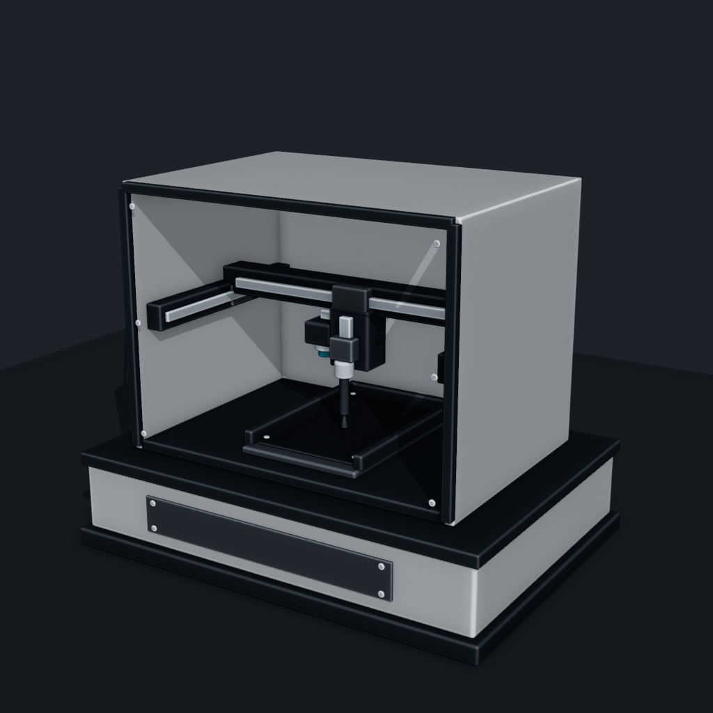

# Mechanical CUBE AI Control

用于手机自动化测试的三轴机械 CUBE，可通过龙门结构完成 X/Y 定位、Z 轴触笔点击，并由下视摄像头把页面图像回传给 AI，形成“识别—坐标转换—执行—二次验证”的控制闭环。



## 当前交付

- 最新融合配音成片：[`releases/latest/mechanical-cube-main-ai-integrated-voiceover.mp4`](releases/latest/mechanical-cube-main-ai-integrated-voiceover.mp4)
- 最新融合无声成片：[`releases/latest/mechanical-cube-main-ai-integrated-clean.mp4`](releases/latest/mechanical-cube-main-ai-integrated-clean.mp4)
- AI 操作分镜源片：[`releases/latest/c159cc4d19a03485a4677970789f6f1a.mp4`](releases/latest/c159cc4d19a03485a4677970789f6f1a.mp4)
- 上一版配音成片：[`releases/latest/mechanical-cube-ai-control-voiceover.mp4`](releases/latest/mechanical-cube-ai-control-voiceover.mp4)
- 当前基础模型：[`blender/robot_base_stage01_professional.blend`](blender/robot_base_stage01_professional.blend)
- 透视介绍镜头：[`blender/mechanical_cube_xray_intro.blend`](blender/mechanical_cube_xray_intro.blend)
- AI 控制闭环镜头：[`blender/mechanical_cube_ai_control_loop.blend`](blender/mechanical_cube_ai_control_loop.blend)

## 结构与运动关系

- BOX：长方体底座与中空壳体，内部保持开放，用于容纳手机和运动机构。
- 手机固定器：保证屏幕平面和机械坐标系之间的标定关系稳定。
- Y 轴：两侧导轨承载龙门架，使整根横梁前后移动。
- X 轴：移动头沿龙门横梁左右移动。
- Z 轴：移动头控制触笔垂直升降，每次只点击一个目标。
- 下视摄像头：固定在移动头上，随 X/Y 移动但不随触笔下压。
- AI 闭环：拍照回传、控件识别、像素坐标到机械坐标转换、点击、再次拍照验证。

## 在另一台 Windows 电脑上开始开发

```powershell
git clone https://github.com/GeraltursW/app-graph-journey.git
cd app-graph-journey\mechanical-cube
powershell -ExecutionPolicy Bypass -File .\tools\setup.ps1
```

安装 Blender 5.4 Alpha、Python 3.11+ 和 FFmpeg 后，可直接打开 `blender/` 中的工程继续修改。要从脚本完整重建当前成片：

```powershell
powershell -ExecutionPolicy Bypass -File .\tools\render-latest.ps1 `
  -BlenderExe "D:\tools\blender-5.4.0\blender.exe"
```

首次运行会生成 `output/`。该目录是可再生缓存，不提交到 Git。完整接手步骤、已知限制和验收方法见 [HANDOFF.md](HANDOFF.md)。

将新的 AI 操作分镜重新融合进主片：

```powershell
powershell -ExecutionPolicy Bypass -File .\tools\integrate-ai-storyboard.ps1
```

该脚本保留主片前 14 秒结构介绍，以 0.75 秒柔和过黑转场接入 AI 分镜，并根据 `config/mechanical_cube_integrated_voiceover.json` 重新生成同步旁白。

## 目录说明

```text
mechanical-cube/
├─ assets/             必要参考图与手机页面素材
├─ blender/            各阶段可编辑 .blend 工程
├─ config/             字幕与中文配音时间轴
├─ docs/               架构、迭代史、排障和预览图
├─ releases/           代表性迭代视频与最终成片
├─ scripts/            Blender 建模、动画、渲染和配音脚本
└─ tools/              环境检查与一键重建脚本
```

## 推荐工作流

1. 修改 `scripts/`，让模型变化可以重复生成；必要时同步保存新的 `.blend`。
2. 先低分辨率验证运动和构图，再生成完整 PNG 帧序列。
3. 使用 FFmpeg 编码和转场，最后生成配音版。
4. 新迭代放入 `releases/iterations/`，稳定版本放入 `releases/latest/`。
5. 更新 `CHANGELOG.md` 和 `HANDOFF.md` 后再提交。

