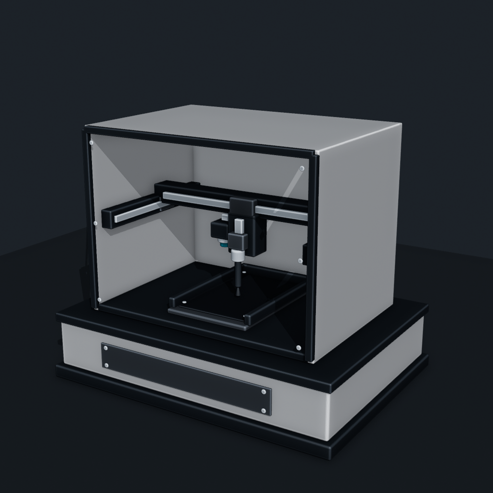

# Mechanical CUBE AI Control

用于手机自动化测试的三轴机械 CUBE，可通过龙门结构完成 X/Y 定位、Z 轴触笔点击，并由下视摄像头把页面图像回传给 AI，形成“识别—坐标转换—执行—二次验证”的控制闭环。



## 当前交付

- v1.9.0：两版主片均为 1920×1080 / 60 fps，新增独立底部字幕区域。画面说明与字幕统一 Microsoft YaHei，完整画面保留，不遮挡手机和图表。
- 机械手旁白使用 `+0%` 正常语速，无音频变速；五步演示随语音延长到 23.4 秒，章节过渡 6.23 秒。
- 字幕源文件：[`../videos/subtitles/`](../videos/subtitles/)（SRT / ASS）；正常语速机械手段：[`releases/latest/mechanical-natural-voiceover.mp4`](releases/latest/mechanical-natural-voiceover.mp4)。
- [机械手章节带字幕预览](releases/latest/mechanical-natural-preview.mp4)；[最终时间轴](docs/final-delivery-timeline.json)；[交付检查记录](docs/final-delivery-validation.json)。两版全片解码正常，字幕时间与版面通过检查，机械手旁白逐段与原速 WAV 对齐，输出无音频削波。
- 固化用例时只保留绿色正确路径：ROOT → 我的页面 → 我的喜欢 → 视频详情。“朋友页查找未命中”只用于展示探索过程，不进入保存的用例。
- 第五幕示例更新：点击底部“朋友”→滑动查找未命中→直接点击底部“我”→找到“我的喜欢”→打开视频。朋友与我为同级 Tab，水平连接，不包含返回操作。
- 第二幕（00:06–00:14）的画面文案和配音统一为“人工智能持续探索页面，理解页面层级。”，已同步两版完整主片。
- 第二幕含配乐预览：[`releases/latest/page-exploration-preview.mp4`](releases/latest/page-exploration-preview.mp4)；独立可编辑工程：[`blender/page-exploration.blend`](blender/page-exploration.blend)。
- 100.03 秒完整主片：[`../videos/application-knowledge-graph-with-mechanical-replay.mp4`](../videos/application-knowledge-graph-with-mechanical-replay.mp4)
- 71.4 秒独立主片也已同步第五幕修改，保留其连续配乐：[`../videos/application-knowledge-graph-and-data.mp4`](../videos/application-knowledge-graph-and-data.mp4)。
- 第五幕已完整合入主片：1.2 秒柔和推进进入，1.4 秒保持节点位置接入用例卡片，文字错开淡入淡出。
- 当前主片第一帧直接显示“应用知识图谱”；原片前 30 秒背景音乐循环铺满全片，独立旁白保留。
- 第五幕输入仍为“疑似问题场景”；AI 从 ROOT 探索到朋友页，查找未命中后发现并补全“朋友 → 我”的同级切换关联，再将实际路径固化为用例。
- 第五幕带配音和音乐的衔接预览：[`releases/latest/scenario-path-preview.mp4`](releases/latest/scenario-path-preview.mp4)。
- 早期结构介绍与 AI 演示合成：[`releases/latest/mechanical-cube-main-ai-integrated-voiceover.mp4`](releases/latest/mechanical-cube-main-ai-integrated-voiceover.mp4)（保留历史配音速度）
- 早期融合无声成片：[`releases/latest/mechanical-cube-main-ai-integrated-clean.mp4`](releases/latest/mechanical-cube-main-ai-integrated-clean.mp4)
- AI 操作分镜源片：[`releases/latest/c159cc4d19a03485a4677970789f6f1a.mp4`](releases/latest/c159cc4d19a03485a4677970789f6f1a.mp4)
- 最新结尾（测试完成 → 数据汇聚 → 报表，统一字体、含旁白）：[`releases/latest/analytics-outro-typography-voiceover.mp4`](releases/latest/analytics-outro-typography-voiceover.mp4)
- 最新分析镜头 Blender 源文件：[`blender/final_analytics_v3.blend`](blender/final_analytics_v3.blend)
- 上一版配音成片：[`releases/latest/mechanical-cube-ai-control-voiceover.mp4`](releases/latest/mechanical-cube-ai-control-voiceover.mp4)
- 当前基础模型：[`blender/robot_base_stage01_professional.blend`](blender/robot_base_stage01_professional.blend)
- 透视介绍镜头：[`blender/mechanical_cube_xray_intro.blend`](blender/mechanical_cube_xray_intro.blend)
- AI 控制闭环镜头：[`blender/mechanical_cube_ai_control_loop.blend`](blender/mechanical_cube_ai_control_loop.blend)

## 结构与运动关系

- BOX：长方体底座与中空壳体，内部保持开放，用于容纳手机和运动机构。
- 手机固定器：保证屏幕平面和机械坐标系之间的标定关系稳定。
- Y 轴：两侧导轨承载龙门架，使整根横梁前后移动。
- X 轴：移动头沿龙门横梁左右移动。
- Z 轴：移动头控制触笔垂直升降，每次只点击一个目标。
- 下视摄像头：固定在移动头上，随 X/Y 移动但不随触笔下压。
- AI 闭环：拍照回传、控件识别、像素坐标到机械坐标转换、点击、再次拍照验证。

## 在另一台 Windows 电脑上开始开发

```powershell
git clone https://github.com/GeraltursW/app-graph-journey.git
cd app-graph-journey\mechanical-cube
powershell -ExecutionPolicy Bypass -File .\tools\setup.ps1
```

安装 Python 3.11+、FFmpeg 和依赖后，重建当前带字幕交付版：

```powershell
pwsh -File .\tools\build-final-delivery.ps1 -ReuseRenders
```

去掉 `-ReuseRenders` 可重新生成正常语速配音、机械手画面与转场；已缓存原始语音，文案未变时无需联网合成。字体和文案参数在 `config/final_delivery.json`，主片字幕文案在 `config/main_caption_script.json`。旧的 `render-latest.ps1` 只用于重建早期机械结构介绍。安装 Blender 5.4 Alpha 后可直接编辑 `blender/`。完整流程见 [HANDOFF.md](HANDOFF.md)。

以下为历史机械分镜和 88.8 秒基片的生成入口，最终交付还需运行上述字幕与正常语速流程。将新的 AI 操作分镜融合进早期结构介绍：

```powershell
powershell -ExecutionPolicy Bypass -File .\tools\integrate-ai-storyboard.ps1
```

该脚本保留主片前 14 秒结构介绍，以 0.75 秒柔和过黑转场接入 AI 分镜，并根据 `config/mechanical_cube_integrated_voiceover.json` 重新生成同步旁白。

要把机械手复现方案插入 10 月 27 日长片的 09 镜头之后：

```powershell
pwsh -File .\mechanical-cube\tools\insert-into-long-film-after-shot09.ps1
```

插入后顺序为“09 实验室手机复现 → 4 秒章节过渡 → 机械手 AI 复现方案 → 测试完成与数据汇聚 → 10 数据分析”，成片时长约 88.8 秒。机械手最后一帧连续缩放为设备卡片，性能、功耗、热三路数据流向报表，以 1 秒叠化进入黑白斜纹背景的图表。旁白为“测试完成后，性能、功耗、热等数据同步汇聚，数据报表一目了然”。

从源文件重建这一段：

```powershell
pwsh -File .\mechanical-cube\tools\build-analytics-outro.ps1 -BlenderExe "D:\tools\blender-5.4.0\blender.exe"
```

生成文件位于 `mechanical-cube/output/final-analytics-v3/`。检查后将 `analytics-outro-voiceover.mp4` 复制到 `releases/latest/`，再运行长片合成脚本。初次需要执行 `tools/setup.ps1` 安装 Pillow 和 edge-tts。图表数值为演示数据。

最后处理片头和循环背景音乐（不需要重新渲染 Blender，也不需要联网）：

```powershell
python .\mechanical-cube\scripts\finalize_long_film.py
```

输出为 `mechanical-cube/output/application-knowledge-graph-final-music.mp4`，检查后可替换发布主片。脚本用完整标题画面覆盖首秒，保持 88.8 秒时长和配音同步。音乐源为 `assets/audio/music-first-30s.flac`，重复三次，在 29.4 秒及 58.8 秒开始 0.6 秒交叉淡化，末尾柔和淡出。参数位于 `config/long_film_audio.json`。

原片音乐与配音已混在同一音轨，音乐素材使用匹配的干净旁白参考进行相减提取；无损 FLAC 已随工程保存。需要重新提取时，安装 NumPy 并运行 `scripts/extract_background_music.py`。普通合成仅依赖 Python 标准库和 FFmpeg。

## 第五幕：疑似问题场景

```powershell
pwsh -File .\mechanical-cube\tools\build-scenario-path.ps1
```

该命令生成 21 秒新分镜及配音，再合成至 88.8 秒主片。现有音乐和片头逻辑继续使用 `finalize_long_film.py`。输出到 `mechanical-cube/output/scenario-path-v1/`，检查后再替换发布主片。

同一命令也输出 71.4 秒独立主片，使用 `integrate_scenario_path.py --preserve-source-music`。底片为 `releases/iterations/12-app-graph-data-continuous-music-v1.6.mp4`；仅在 26–45 秒用匹配的干净配音参考消除旧旁白并加入新旁白，保留原来的连续配乐。

- 当前动画：`scripts/render_friends_scenario.py`（Pillow + FFmpeg，720p / 60 fps）；原 `render_scenario_path.py` 保留为上一版逻辑参考。
- 文案：`config/scenario_path_voiceover.json`；已合成旁白保存在 `assets/audio/scenario-path-voiceover.wav`。
- 基础合成：`scripts/integrate_scenario_path.py`；新分镜主体位于主片 26–47 秒，随后由下述最终转场步骤接入用例固化。
- 合成底片固定为 `releases/iterations/11-long-film-looped-music-v1.6.mp4`，重复执行不会累积叠化效果。
- 配音替换范围为 26–45 秒；45 秒后的用例固化旁白保持连续。
- 相似页面召回保留为约 2.7 秒独立画面，展示朋友页、我的页面、我的喜欢三张候选截图。
- 朋友页和我的页面处于同一层级；初始没有横向连线。12.2 秒开始点击底部“我”，AI 补出紫色水平连接；不经过 ROOT，不出现返回箭头。
- 6.5–10 秒在朋友页内容区域上滑，底部导航固定；10–12.2 秒显示未命中。14.3 秒后进入我的页面，定位喜欢列表并验证成功。
- 目标确认后，探索中的朋友分支和紫色尝试连线淡出；仅将 ROOT → 我 → 喜欢 → 视频展开为绿色路径。同步生成 `releases/latest/scenario-case-clean.mp4`，替换 47–52 秒用例卡片，只保存三个正确点击步骤。

第五幕转场由 `scripts/smooth_scenario_transitions.py` 完成，已纳入 `build-scenario-path.ps1`：25.2–26.4 秒进入新场景；47–48.4 秒从水平路径接入就位后的用例卡片。文字区域采用边缘柔化与错峰淡化，避免同时显示两套字幕。该步骤直接复制主片音轨。随后 `integrate_page_exploration.py` 合入第二幕的新画面与配音，最终文件名分别以 `and-data-final.mp4` 和 `mechanical-final.mp4` 结尾。

第二幕需要重新修改时，先更新 `config/page_exploration.json` 和 `config/page_exploration_voiceover.json`，执行 `tools/build-page-exploration.ps1 -BlenderExe "你的 Blender 路径"`，再执行上面的完整合成命令。已有可复用的第二幕素材随仓库交付，普通重建无需再次运行 Blender。

## 目录说明

```text
mechanical-cube/
├─ assets/             必要参考图与手机页面素材
├─ blender/            各阶段可编辑 .blend 工程
├─ config/             字幕与中文配音时间轴
├─ docs/               架构、迭代史、排障和预览图
├─ releases/           代表性迭代视频与最终成片
├─ scripts/            Blender 建模、动画、渲染和配音脚本
└─ tools/              环境检查与一键重建脚本
```

## 推荐工作流

1. 修改 `scripts/`，让模型变化可以重复生成；必要时同步保存新的 `.blend`。
2. 先低分辨率验证运动和构图，再生成完整 PNG 帧序列。
3. 使用 FFmpeg 编码和转场，最后生成配音版。
4. 新迭代放入 `releases/iterations/`，稳定版本放入 `releases/latest/`。
5. 更新 `CHANGELOG.md` 和 `HANDOFF.md` 后再提交。

